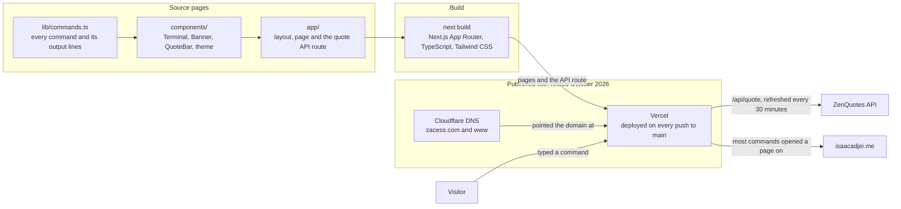

# zacess-pages

[](https://github.com/zaccesss/zacess-pages/releases/latest)
[](LICENSE)
[](https://zacess.com)

> [!IMPORTANT]
> Retired on 13 October 2026. zacess.com is now the site for Zacess, the free, open-source accessibility
> reader, built in [zacesshq/website](https://github.com/zacesshq/website). This repo is kept read-only as
> the history of the terminal landing page that used to live there.

I built this as the landing page for [zacess.com](https://zacess.com) while the full site was still to come. Instead of a static "under construction" page, it is a real terminal in the browser: boot sequence, blinking cursor, line-by-line output, command history and tab autocomplete, everything modelled after an actual CLI session rather than a styled page pretending to be one.

Most commands navigate to pages on my portfolio at [isaacadjei.me](https://isaacadjei.me) while a few run local interactions like downloading my CV, opening a mail client or collecting a suggestion. A daily motivation quote from the ZenQuotes API sits underneath the terminal and refreshes every 30 minutes.

## How it was built and served



Built with Next.js App Router, TypeScript, Tailwind CSS and a server-side API route.

> [!NOTE]
> The terminal no longer runs anywhere. To try it, clone the repo and run `npm install` then `npm run dev`.

## Features

**Terminal behaviour**

- Boot sequence: a short ZacessOS status readout prints on load before the prompt is ready
- Line-by-line output: each response line prints with a short delay rather than appearing all at once
- Command history: the up and down arrow keys cycle through previously entered commands
- Tab autocomplete: completes on a single match, lists all matches when there is more than one
- Suggest mode: an interactive prompt that collects a suggestion and opens a pre-filled mailto link
- `clear` wipes only the output typed after boot, keeping the boot lines intact
- Typed input is HTML-escaped before being echoed back, so it can't inject markup into the output

**Visual**

- A blinking block cursor, with the real input hidden off-screen and its text mirrored into a visible span
- A three-colour scheme: cyan for prompts, green for commands, amber for output
- A custom scrollbar styled to match the terminal palette
- Dark and light mode toggle in the top right, though the terminal's own colours stay the same in both
- A responsive layout with a tap-to-type hint on touch devices

**Window controls**

| Control | Colour | Behaviour |
|---|---|---|
| Close | Red | Collapses the terminal to a restore button |
| Minimise | Yellow | Hides the content, keeps the titlebar visible |
| Maximise | Green | Expands to a full viewport overlay |
| `+` | Yellow | Opens a fresh terminal session with a new boot sequence |

## Commands

Type any of the following into the terminal input.

Navigate, opens isaacadjei.me:

| Command | Description |
|---|---|
| `whoiszac` | Homepage |
| `about` | About me |
| `projects` | Engineering work |
| `experience` | Work history |
| `skills` | Technical stack |
| `blog` | Writing and thoughts |
| `contact` | Get in touch |
| `links` | GitHub, LinkedIn and more |

Local:

| Command | Description |
|---|---|
| `journey` | Background and story |
| `cv` | Download CV (PDF) |
| `collaborate` | Work with me, opens a mail client |
| `suggest` | Suggest what to build next |
| `status` | Site build status |
| `clear` | Clear the terminal |
| `help` | Show all commands |

Unlockables, if you know, you know:

| Command | Description |
|---|---|
| `zac` | Classified |
| `sudo` | Try your luck |
| `whoami` | Good question |

Keyboard shortcuts: `Enter` runs a command, `↑` and `↓` cycle history, `Tab` autocompletes and clicking anywhere in the terminal focuses the input.

## Tech stack

- **Framework**: Next.js App Router with TypeScript
- **UI**: React
- **Styling**: Tailwind CSS, with CSS custom properties for the terminal palette
- **Font**: JetBrains Mono via `next/font/google`
- **Theming**: next-themes, dark mode by default
- **Quote API**: ZenQuotes, proxied through a Next.js API route to avoid CORS
- **Deployment**: Vercel, which deployed every push to `main` while the page was live
- **DNS**: Cloudflare, which now points zacess.com at the Zacess site instead

## File structure

```
zacess-pages/
├── app/
│   ├── api/
│   │   └── quote/
│   │       └── route.ts        # ZenQuotes proxy API route
│   ├── globals.css             # terminal CSS variables and all terminal classes
│   ├── layout.tsx              # root layout, font, metadata, ThemeProvider
│   └── page.tsx                # page composition (Banner + Terminal + QuoteBar)
├── components/
│   ├── Banner.tsx               # under construction banner with image and links
│   ├── QuoteBar.tsx             # daily motivation quote with auto-refresh
│   ├── Terminal.tsx             # full terminal: boot, input, history, commands
│   ├── ThemeProvider.tsx        # next-themes wrapper
│   └── ThemeToggle.tsx          # fixed top-right light/dark toggle
├── lib/
│   └── commands.ts              # all command definitions and output lines
├── public/
│   ├── brand/                   # transparent Zaccess mark, SVG plus PNG sizes
│   ├── Isaac_Adjei_CV.pdf       # CV download target
│   ├── giphy.gif                # animation shown by an unlockable command
│   ├── underconstruction.jpg    # banner image
│   └── logo.png                 # favicon
├── next.config.mjs
├── tailwind.config.ts
├── tsconfig.json
└── README.md
```

## Updating content

All command output lives in `lib/commands.ts`. Each command is a `CommandDef` with a `lines` array of HTML strings, one string per output line. An empty string `''` inserts a blank spacer line.

**Editing an existing command**: find it by name and edit its `lines` array.

```ts
journey: {
  description: 'background and story',
  lines: [
    '<span class="lbl">origin:</span>    Ghana',
    '<span class="lbl">location:</span>  United Kingdom  (arrived 2022)',
    // add or edit lines here
  ],
},
```

**Adding a new command**: add it to `COMMANDS` in `lib/commands.ts`, then add it to the `help` command's lines so it shows up in the help list. Tab completion picks it up automatically.

```ts
mycommand: {
  description: 'short description',
  lines: [
    '<span class="lbl">section title:</span>',
    '',
    '  <span class="arr">-></span>  first item',
    '  <span class="arr">-></span>  second item',
  ],
},
```

**Adding a redirect command**: set `redirect` to the target URL. A `mailto:` link opens in the same tab, anything else opens in a new one.

```ts
mypage: {
  description: 'opens mypage.com',
  lines: [
    '<span class="lbl">opening:</span>  <a href="https://mypage.com" target="_blank">mypage.com</a>',
    '<span class="dim">launching in new tab...</span>',
  ],
  redirect: 'https://mypage.com',
},
```

CSS classes available in output: `lbl` (cyan, labels and section headers), `arr` (cyan, arrow list items), `err` (red, error messages), `dim` (grey, hints and secondary info).

## Deployment

While it was live the page was hosted on Vercel, connected to this GitHub repo. Every push to `main` triggered a deployment. DNS was managed through Cloudflare, pointing `zacess.com` and `www.zacess.com` at Vercel. No environment variables were needed: the ZenQuotes API is public and proxied through `/api/quote` with no key.

The Vercel project is gone, so a push changes nothing online. To run the page, use `npm run dev` locally or deploy the repo to a host of your own.

## Roadmap

| Status | Item |
|---|---|
| Done | Terminal interface with boot sequence |
| Done | Command history, tab autocomplete |
| Done | Blinking cursor, line-by-line output |
| Done | Next.js App Router rebuild, TypeScript, Tailwind CSS, next-themes |
| Done | ZenQuotes API integration |
| Done | Mac-style window controls |
| Done | Mobile support |
| Done | Favicon, easter egg commands |
| Done | Vercel deployment with custom domain |
| Superseded | Full zacess.com experience, now the Zacess site in [zacesshq/website](https://github.com/zacesshq/website) |
| Dropped | Interactive projects showcase, case studies and the `suggest` ideas, retired with the page |

## License and contact

Licensed under [PolyForm Noncommercial 1.0.0](LICENSE). See [NOTICE.md](NOTICE.md) for third-party media terms.

Open an [issue](https://github.com/zaccesss/zacess-pages/issues) in this repository for questions or bugs. See [SUPPORT.md](SUPPORT.md) for the full breakdown of where to go.

> [!TIP]
> Reach me directly at [contact@isaacadjei.me](mailto:contact@isaacadjei.me) or through the [website contact page](https://isaacadjei.me/contact).

> [!IMPORTANT]
> For a security issue, follow [SECURITY.md](SECURITY.md) rather than posting publicly.
